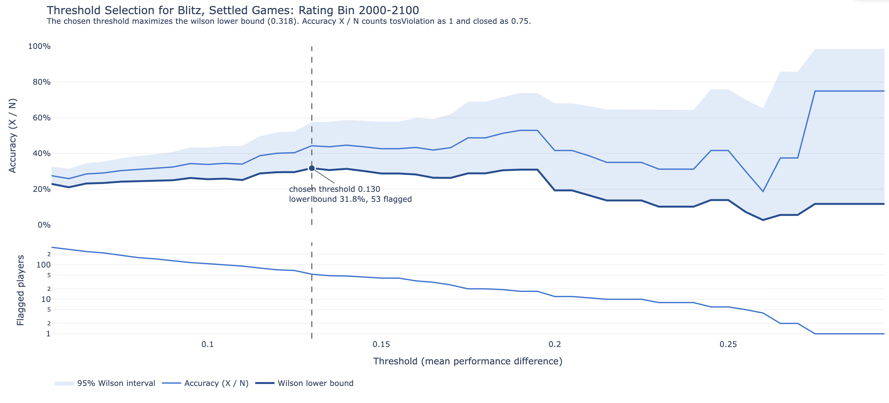

# filter_suspicious_players

This is a work-in-progress package that retrieves training data from the [lichess.org open database](https://database.lichess.org/), then trains a statistical model to detect suspicious players. Currently the app is still in development.

## Installing Dependencies
To install dependencies, run the following command:
```bash
pip install -r requirements.txt
```

### Data Download and Preprocessing
To download and preprocess data from the lichess.org open database, you can run the following command (specifying the year and month of the data you want to download):

```bash
python3 download_and_preprocess.py --year 2018 --month 1
```

The data is read from the [Lichess/standard-chess-games](https://huggingface.co/datasets/Lichess/standard-chess-games) dataset on Hugging Face, which contains the lichess.org open database as parquet files partitioned by year and month. Because parquet files are stored by column, the script uses [DuckDB](https://duckdb.org/docs/api/python/overview) to download only the header columns it needs (players, ratings, rating changes, result, time control, and date/time) and never downloads the moves. For Jan 2018, this is 512 MB instead of the full 11.9 GB. Note that the Hugging Face dataset is updated some time after lichess publishes each month, so the most recent months may not be available yet.

Each month is split into many parquet files, which are downloaded one at a time and cached in `lichess_downloaded_games/lichess_db_standard_rated_<year>-<month>/`. If Hugging Face rate limits the download, the script waits and retries, and if the script is interrupted, running it again will resume from the files that have already been downloaded.

Warning: downloading and preprocessing will take a long time to complete for more recent data (Jan 2018 takes around an hour, and recent months contain several times as many games). Logging in with a Hugging Face [access token](https://huggingface.co/settings/tokens) (a read-only token is sufficient) raises the rate limits, which speeds up the download considerably. The following command (installed with `pip install huggingface_hub`) saves the token to `~/.cache/huggingface/token`, outside of this repo, where the script will find it automatically (alternatively, you can set the `HF_TOKEN` environment variable):

```bash
huggingface-cli login
```

You can use caffeinate to prevent your computer from going to sleep while the script is running.

```bash
caffeinate -is python3 download_and_preprocess.py --year 2018 --month 1
```

The `download_and_preprocess.py` script creates the `lichess_player_data` directory, to which the following files are saved, and then generates exploratory plots:
- `lichess_db_standard_rated_<year>-<month>.csv`: one row per player per game, with the player's rating, opponent's rating, score, rating change, whether the game had an increment, and the date and time of the game. Games are classified as bullet, blitz, rapid, or classical based on the rating pool in the game's event name (older games label the classical rating pool as "Standard").
- `lichess_db_standard_rated_<year>-<month>_player_features.csv`: one row per player and time control, created by `make_player_features.py` (see below).

### Player Features
`make_player_features.py` aggregates each player's games by time control, for players with at least 30 games in that time control. The main feature is the performance difference: the player's actual score minus their expected score under the Glicko-2 rating system, averaged over their games (`mean_perf_diff`).

Rating deviation (RD) is not included in the lichess game data, so each player's RD before each game is estimated from the size of their rating change (e.g. +10 for beating an equal opponent corresponds to an RD of around 60, while +150 corresponds to an RD of around 290). Players who are new to the rating pool start at 1500 with a high RD and move quickly towards their true rating, so a strong player who is new to the pool will overperform on the way up, and a beginner will underperform on the way down. To separate this effect from genuine over- or underperformance, the performance difference, mean rating, and rating change are also aggregated separately for settled games (estimated RD < 80) and new games (estimated RD >= 80), with the suffixes `_settled` and `_new`.

### Exploratory Plots
`make_exploratory_plots.py` saves interactive html plots to the `exploratory_plots` directory, showing the distribution of mean performance difference by rating bin for bullet, blitz, and classical. Settled and new games are plotted separately (`_perf_diff_settled` and `_perf_diff_new`), on the same x-axis range so they can be compared directly. The plots can also be generated from an existing player features file:

```bash
python3 make_exploratory_plots.py lichess_player_data/lichess_db_standard_rated_2018-01_player_features.csv
```

### Model Description
This is a simple statistical model that flags players who have performed a certain threshold above their expected performance under the Glicko-2 rating system. The expected performance takes into account each player's complete game history and opponents in the span of the training data. A separate threshold is fitted for each time control, each 100 point rating bin, and for settled games and new games (see Player Features above), because a legitimate strong player who is new to the rating pool will naturally overperform on the way up from 1500, while the same rise for a settled player is much rarer. A player is evaluated on their settled games if they have at least 30 of them, and on their new games if they have at least 10, and is flagged if either is above the threshold for their rating bin. The thresholds are initialized to default values (0.10 for settled games and 0.20 for new games), and then adjusted for each rating bin in the training data.

### Data Labelling
Players are labelled by the status of their lichess account, using `PlayerAccountHandler`, which requests up to 300 players at a time from the lichess API. The lichess API is limited to 8,000 users every 10 minutes and 120,000 users per day, and asks that it not be used to download all users, so the handler makes one request every 24 seconds, waits at least 70 seconds if it is rate limited, and requests at most 110,000 users per run. If the handler is given a cache file path, account statuses are saved after each request, so players are never requested twice and an interrupted run can be resumed. Only the players in the top 10% of performance difference within each rating bin are labelled (around 20,000 players for Jan 2018), since these are the only players that thresholds are searched over.

### Model Training
We define `N` as the number of players who have performed above some threshold, and the estimated number of cheaters as `X = 0.00 * N_open + 0.75 * N_closed + 1.00 * N_violation` where `N_open` is the number of players with open accounts, `N_closed` is the number of players with closed accounts, and `N_violation` is the number of players with a terms of service violation (where `N = N_open + N_closed + N_violation`). Players whose accounts are not found are excluded. The default metric used to evaluate the performance of the threshold is the lower bound of the 95% [Wilson confidence interval](https://en.wikipedia.org/wiki/Binomial_proportion_confidence_interval#Wilson_score_interval) for the accuracy `X / N` (`metric="wilson_lower_bound"`): the accuracy we can be confident in among the players above the threshold. A threshold that is too low flags many players, but at an accuracy close to that of all players, while a threshold that is too high flags so few players that the confidence interval is very wide, so the lower bound is highest in between. For example, 3 of 3 flagged players being cheaters only tells us the accuracy is at least 44%, while 60 of 100 tells us it is at least 50%. Alternatively, `metric="log_flagged"` uses `log(N+1) * X / N`, which rewards the accuracy and the number of flagged players, but continues to increase as more players are flagged even when they are no more likely to be cheating than any other player. The threshold is chosen by a grid search in steps of 0.005, from the 90th percentile of performance difference in the rating bin (or 0, if higher) up to the highest performance difference.

### Sample code:
```python
import pandas as pd
from player_account_handler import PlayerAccountHandler
from model import PlayerAnomalyDetectionModel

BASE_FILE_NAME = 'lichess_db_standard_rated_2018-01'
train_data = pd.read_csv(f'lichess_player_data/{BASE_FILE_NAME}_player_features.csv')
player_account_handler = PlayerAccountHandler('lichess_player_data/account_statuses.csv')
model = PlayerAnomalyDetectionModel(player_account_handler)
model.fit(train_data)
model.save_model(f'{BASE_FILE_NAME}_model')
predictions = model.predict(train_data)
```

### Model Evaluation

When the model is fitted, plots showing how the threshold was chosen are saved to the `model_plots` directory as html files (to view in a browser) and json files:
- `test_model_thresholds_overview`: the threshold chosen for every time control, settled or new games, and rating bin, and the Wilson lower bound at that threshold.
- `test_model_thresholds_<time control>_<settled or new>_<rating bin>`: for one rating bin, the accuracy `X / N` at each threshold with its 95% Wilson confidence interval, the number of flagged players, and the chosen threshold.

The figure object can be loaded from the json file, as shown in the example code snippet below:

```python
import json
import plotly.io as pio

f = open('model_plots/test_model_thresholds_blitz_settled_1800-1900.json')
data = json.load(f)

fig = pio.from_json(data)
fig.show()
```

Below is an example of the threshold vs accuracy plot below for players in the 1400-1500 range for classical chess based on training data from the month of Jan 2015.



### Assumptions
The model is built on the assumption that cheating is a rare occurrence in any data set on which the model is trained. There may be unexpected behavior if the training data is composed predomininantly of players who are cheating. The model will retain its default thresholds in the event that no players have shown any significant deviations from the mean expected performance in their rating bin. 

### Unit Tests
Currently working on unit tests, which can be run with the following command:
```make test```, or if you want to run test files individually ```PYTHONPATH=. pytest tests/test_model.py```

To-do:
- implement progress bars for preprocessing data and model training
- currently running tests to process > 1GB files, which I may outsource to GCP
- complete data labelling using lichess API calls, with a workaround or retry request if API rate limiting occurs 
- write unit tests for scripts that perform feature extraction and data labelling
- complete unit tests for `PlayerAnomalyDetectionModel` class and methods (in-progress)
- possible benchmarks for length of time to execute data downloading, preprocessing, and model training depending on the size of the raw data